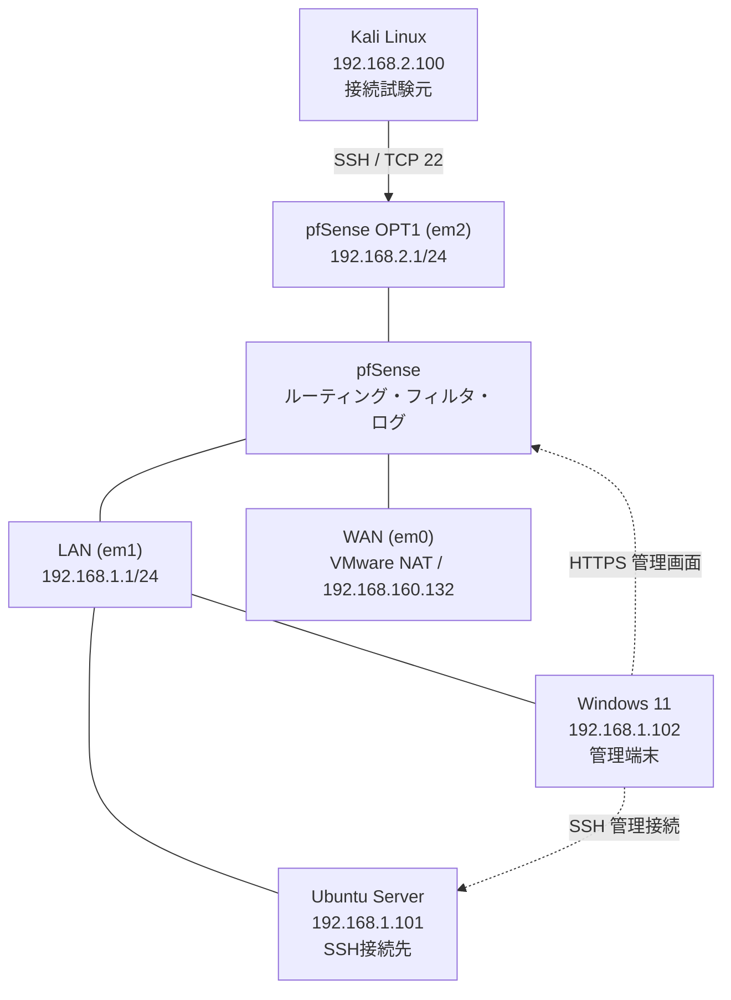
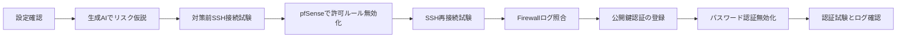

# Frontier AI Security Risk Analysis Lab

**CRXソリューションの「フロンティアAI」を参考にした、生成AIによるセキュリティリスク分析・対策検証の自主学習プロジェクト**

NTTドコモビジネスのCRXソリューションにおける「フロンティアAI」への関心をきっかけに、生成AIを活用したリスク分析と、実機検証による評価を疑似体験するために構築した隔離型ラボです。VMware Workstation 上にKali Linux、pfSense、Ubuntu Server、Windows 11 を使用し、**SSHの接続許可範囲と認証方式を分析し、対策前後の実測結果を比較**しました。

> **独自に設計した学習・検証用ラボ**です。CRX製品・実際のフロンティアAI機能を使用・再現したものではありません。生成AIによる設定分析は、検証を補助する用途で使用しました。AIの判断をそのまま正解とせず、接続試験とログで照合しています。

## 目的

**中心テーマはフロンティアAIを参考にしたリスク分析の疑似体験**です。pfSenseによる通信制御やSSH認証変更は、AIの指摘を検証するための手段として位置付けます。SOC運用や商用CRXシステムの再現は目的としていません。

1. SSHの設定値からリスク仮説を立てる。
2. Kali → Ubuntu のSSH接続を試し、pfSenseの通信制御前後で挙動を比較する。
3. Windowsからの管理接続を維持し、UbuntuのSSH認証を公開鍵方式へ移行する。
4. pfSenseのファイアウォールログとUbuntuの認証ログから挙動を検証する。

## ネットワーク構成

Kali側がVMnet3、Ubuntu/Windows側がVMnet2です。Kali→Ubuntu の**異なるサブネット間**の通信をpfSenseで制御しました。Windows→Ubuntuは同じLAN内の通信で、**pfSenseの転送ルールを通るわけではありません**。そのためWindowsの管理接続成功はUbuntu側への到達性の確認であり、pfSenseに「Windowsだけを許可するルール」を設定した証拠ではありません。

詳細: [ネットワーク構成](docs/network-architecture.md)

## 実験結果（概要）

| 検証 | 条件 | 観測結果 |
|---|---|---|
| 通信制御前 | OPT1でKali → UbuntuのTCP 22をPass | KaliからSSHログイン成功 |
| 通信制御後 | 上記Passルールを無効化 | Kaliの新規SSH接続がタイムアウト |
| pfSenseログ | OPT1でKali→Ubuntu:22を検索 | Pass 1件、Default deny 5件を表示（取得画面内） |
| 正規接続 | Windows → Ubuntu | SSHログイン成功 |
| SSH認証変更前 | `PasswordAuthentication yes` | 認証ログに `Accepted password` |
| SSH認証変更後 | `PasswordAuthentication no`、公開鍵認証有効 | 公開鍵ログイン成功。パスワードのみの試行は拒否（操作試験） |

重要: SSHの「タイムアウト」単独では遮断原因は断定できません。pfSenseの**同じ送信元・宛先・宛先ポートを示す遮断ログ**と組み合わせて判断しました。また `Connection reset ... [preauth]` は認証前に接続が終了した記録であり、それ単独でパスワード認証拒否の確証とは扱いません。

## フロンティアAI疑似体験の検証フロー

AIはSSH設定を入力として、リスクの仮説と対策候補を提示しました。その後、接続試験・ファイアウォール記録・認証ログから仮説と対策の妥当性を確認しました。これは汎用生成AIを分析補助として使用したもので、リスクを自動判定する独自モデルを実装したものではありません。

## 生成AIの指摘と実測結果の対応

| 分析対象・AIによる指摘（要約） | 人による検証 | 観測結果 | 評価・対策 |
|---|---|---|---|
| `PasswordAuthentication yes`：パスワード認証の利用可能性がリスクになり得る | `sshd -T` とSSHログイン、認証ログを確認 | 対策前に `Accepted password` を確認 | 公開鍵認証を用意し、パスワード認証を無効化 |
| Kali側からUbuntuのSSHへ到達できるなら、接続元を絞る必要がある可能性 | Kali `192.168.2.100` からUbuntu `192.168.1.101:22` に接続 | pfSense許可ルール有効時はSSHログイン成功 | 不要な接続元としてKali側の許可ルールを無効化 |
| 接続元の制限後も管理作業を継続できる必要がある | Kaliの新規接続とWindowsの正常接続を比較 | Kaliはタイムアウト、WindowsはSSHログイン成功 | Kali側の遮断ログと管理接続成功を証拠に対策効果を評価 |
| ログで通信制御の成否を裏付ける必要がある | pfSenseのOPT1ログを確認 | 同じ宛先ポート22に対するPassとDefault denyを確認 | 接続試験だけでなくFirewallログと照合 |

この表の「AIによる指摘」は会話で実施した**分析の要約**です。当時のAIへの質問文と完全な回答ログの逐語記録ではありません。再現可能な質問テンプレートと評価上の留意点は[AI分析・実測照合レポート](docs/ai-findings-vs-evidence.md)を参照してください。

## 検証の順序

## 詳細レポート

- [環境と通信経路](docs/network-architecture.md)
- [SSH設定のリスク分析（生成AIの補助）](docs/ssh-risk-analysis.md)
- [pfSense通信制御・ログ検証](docs/firewall-verification.md)
- [SSH公開鍵認証への移行と認証ログ](docs/ssh-authentication.md)
- [生成AI分析と実測結果の照合](docs/ai-findings-vs-evidence.md)
- [スクリーンショットの対応表](images/README.md)

## 主な学び・制約

- `PasswordAuthentication yes` だけで脆弱性と断定せず、到達できる接続元・サービス要件・補完対策も評価する必要がある。
- pfSenseは通過する通信にのみルールを適用する。WindowsとUbuntuが同一LAN内の場合、通常その間のSSH通信はpfSenseを経由しない。
- ファイアウォールの遮断ログとSSH認証ログは観測している段階が違う。遮断された接続は原則としてUbuntuの認証ログに到達しない。
- 同一ラボ内の固定IPと時刻を用いた検証であり、一般の本番ネットワークにそのまま適用する手順ではない。

## 今後の取り組み（未実施）

**Webアプリケーションの認証・アクセス制御**にも対象を広げる予定です。検証用Webアプリを隔離環境に用意し、ログイン機構、アクセス権限の境界、セッション管理などの設定・挙動を生成AIで整理した後、正規ユーザーと権限の異なるユーザーによるアクセス試験で検証します。対策前後のHTTP応答・アプリケーションログを比較することを想定しています。

これは今後の計画であり、現時点で実施済みの成果には含めません。

## 安全・公開上の注意

対象は所有する隔離された仮想マシンのみです。SSH秘密鍵、パスフレーズ、管理パスワード、認証済みセッション情報、設定バックアップを公開しないでください。画像内の環境識別情報・ローカルユーザー名などは公開前に必ず点検してください。
