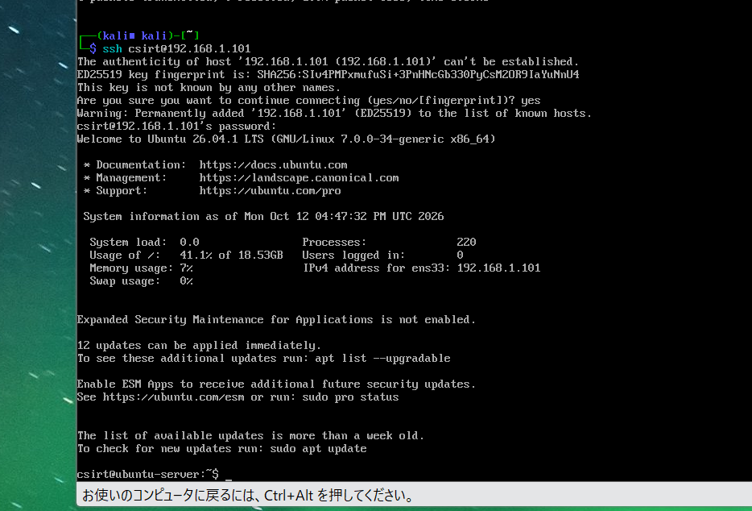
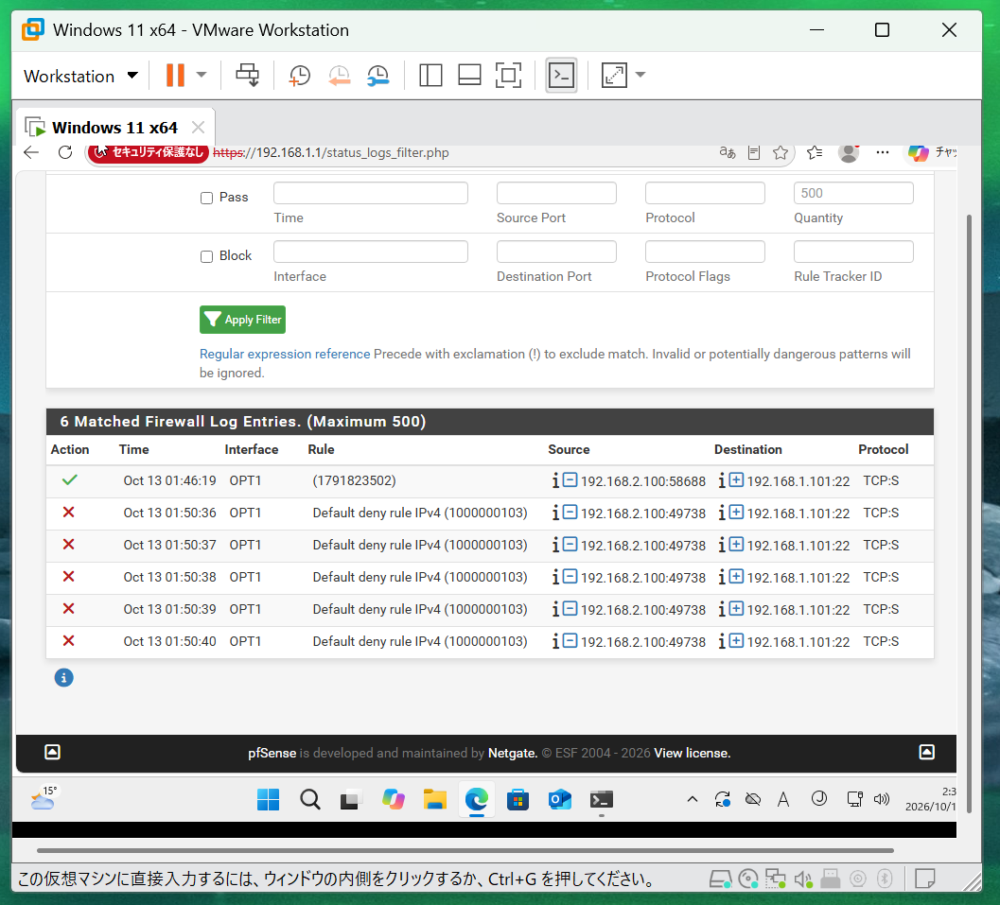

# pfSenseによるSSH接続制御の検証

> AIの対策案を実証するための通信制御検証。実際のCRX製品を利用した結果ではありません。

## ルール（対策前）

| 項目 | 値 |
|---|---|
| Interface | OPT1 |
| Action | Pass |
| Protocol | IPv4 TCP |
| Source | 192.168.2.100（Kali） |
| Destination | 192.168.1.101（Ubuntu） |
| Destination port | 22 (SSH) |
| Description | Allow_Kali_to_Ubuntu_SSH |


## 検証結果

**対策前**: Kali上の `ssh csirt@192.168.1.101` でパスワード認証によるUbuntuログインが成功。



**対策後**: 当該ルールを無効化し反映。Kali上で以下を実行。

```bash
ssh -o ConnectTimeout=5 csirt@192.168.1.101
```

出力:

```text
ssh: connect to host 192.168.1.101 port 22: Connection timed out
```


## pfSenseのFirewallログ

ログ画面の検索結果では、OPT1で以下を観測しました。

| 時刻（pfSense表示） | 送信元 | 宛先 | 動作 | ルール |
|---|---|---|---|---|
| Oct 13 01:46:19 | 192.168.2.100:58688 | 192.168.1.101:22 | Pass | 1791823502 |
| Oct 13 01:50:36–01:50:40 | 192.168.2.100:49738 | 192.168.1.101:22 | Block（5行） | Default deny rule IPv4 (1000000103) |

ログにはTCP・SYN（表示上 `TCP:S`）が記録されています。上記の遮断記録と接続タイムアウトを組み合わせ、Kaliからの**新規**SSH接続がpfSenseで遮断されたことを確認しました。時刻表記は画面の表示値をそのまま記録しています。



## 正常な管理接続の継続

同じVMnet2のWindows（192.168.1.102）からUbuntuへのSSH接続は成功しました。ただしこの通信は基本的にpfSenseを経由しません。「Windows管理通信をpfSenseルールで例外許可した」という意味ではありません。


