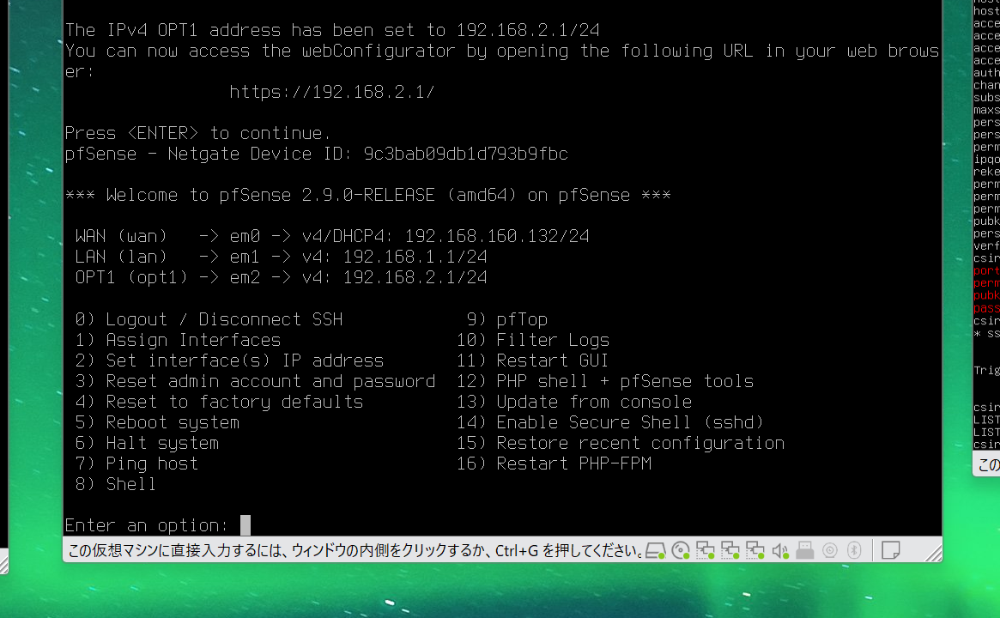

# ネットワーク構成と各端末の役割

> リスク分析を実証するための実験ネットワーク。実際のCRX製品を利用した結果ではありません。

| VM | 役割 | インターフェース / IP | セグメント |
|---|---|---|---|
| Kali Linux | SSHの接続試験元 | eth0: 192.168.2.100/24 | VMnet3 |
| pfSense | ルータ・ファイアウォール・ログ | OPT1: 192.168.2.1/24, LAN: 192.168.1.1/24, WAN: 192.168.160.132/24 | VMnet3, VMnet2, VMware NAT |
| Ubuntu Server | SSH保護対象 | ens33: 192.168.1.101/24 | VMnet2 |
| Windows 11 | 管理端末、SSH正規接続試験 | 192.168.1.102（SSHログから確認） | VMnet2 |

Kaliのデフォルト経路は `default via 192.168.2.1 dev eth0`。これにより別サブネット宛てパケットはpfSenseへ送られる構成です。pfSense LANの接続先はUbuntuおよびWindowsのいるVMnet2です。

**注意**: Kali → Ubuntu の転送通信はOPT1のフィルタ対象です。一方、Windows → Ubuntuの通信は同一セグメント内で行われるため、pfSenseのOPT1による通信制御と同列には比較できません。端末単位でネットワーク制限を評価するには、管理用セグメントを分けるかUbuntu側で接続元制限を追加する必要があります。

