# Frontier AI Security Risk Analysis Lab

> **生成AIでシステムのリスクを分析し、接続試験・ログ・対策結果を使ってAIの判断を評価する自主学習プロジェクト**

NTTドコモビジネスのCRXソリューションにおける「フロンティアAI」への関心から、**リスク分析 → 実機検証 → 対策 → 効果検証 → AIの判断の評価**を、独自の仮想環境で実践しました。

今回はUbuntu ServerのSSHとpfSenseの通信制御を対象に、Ollama上で動くGemma 3（4B）の分析と、実際に観測した設定・通信・認証ログを比較しています。

> **位置づけ：** 本リポジトリは学習目的の独自実験です。CRX製品や「フロンティアAI」の実装・内部モデル・固有機能を利用または再現したものではありません。検証は自身が管理する仮想環境内で実施しています。

## 1. 目的

**生成AIを活用してシステムのセキュリティリスクを分析し、実際の検証と対策を通じて、AIによるリスク分析の有効性を評価する。**

以下の3点を評価します。

1. **リスク分析：** SSH設定やファイアウォールルールから、AIが確認すべきリスク・対策案を整理できるか。
2. **実機検証：** AIの判断を、接続試験・ネットワーク経路・ファイアウォールログ・認証ログと照合できるか。
3. **有効性の評価：** AIの判断が正しい箇所と誤る箇所を特定し、改善すべき入力情報や検証方法を整理できるか。

**AIが「危険」と回答したことだけでは成果としません。何が事実で、何がAIの推測なのかを区別します。**

## 2. 検証環境

### 2.1 全体構成

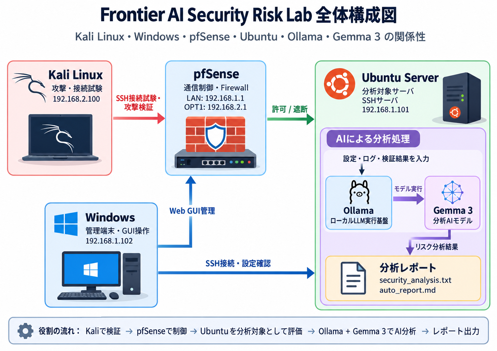

| 構成要素 | ネットワーク / 実行場所 | 役割 |
|---|---|---|
| **Kali Linux** | `192.168.2.100` / VMnet3 | 非管理端末を想定したSSH接続試験 |
| **Ubuntu Server** | `192.168.1.101` / VMnet2 | SSH保護対象、ローカルAI実行環境 |
| **Windows 11** | `192.168.1.102` / VMnet2 | 正規の管理端末、pfSenseのWeb GUI操作 |
| **pfSense 2.9.0** | WAN `192.168.160.132` / LAN `192.168.1.1` / OPT1 `192.168.2.1` | VMnet2・VMnet3間の通信制御とログ記録 |
| **Ollama** | Ubuntu Server上 | ローカルLLMの実行基盤とAPI |
| **Gemma 3（4B）** | Ollamaで実行 | SSH・ネットワーク設定のリスク分析 |
| **Python** | Ubuntu Server上 | AIへの入力・出力保存・検証記録のレポート化 |

**通信経路上の重要な違い：** KaliからUbuntuへのSSH通信は異なるサブネット間の通信で、pfSenseによる制御対象です。一方、WindowsとUbuntuは同一LAN（VMnet2）にあるため、通常のSSH通信はpfSenseを経由しません。

### 2.2 インターフェースと経路の確認

**pfSense：** WAN=`em0`、LAN=`em1`、OPT1=`em2` の割り当てを確認しました。


**Kali：** `ip route` でデフォルトゲートウェイが `192.168.2.1`（pfSense OPT1）であることを確認しました。

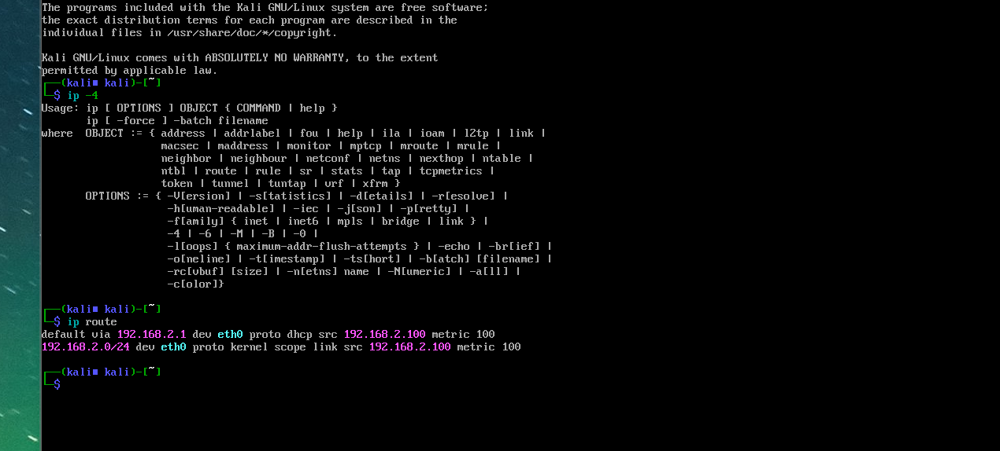

## 3. ワークフローと進捗

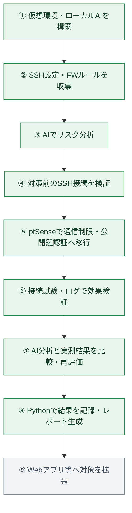

| 工程 | 内容 | 状態 | 主な証拠 |
|---|---|---|---|
| ① 環境構築 | Kali / Ubuntu / Windows / pfSense / Ollama / Gemma 3 | **完了** | 全体構成図、画像01・02 |
| ② 情報収集 | SSH実効設定、通信ルール、接続試験結果の整理 | **完了** | 画像04・07、`ssh_config.txt` 等 |
| ③ AI分析 | Gemma 3で設定・経路・ルールを分析 | **完了** | AI出力画像、`security_analysis.txt` |
| ④ 対策前検証 | KaliからUbuntuへSSHログイン | **完了** | 画像03・09 |
| ⑤ 対策 | pfSenseの許可ルール無効化、SSH公開鍵認証への移行 | **完了** | 画像04・08 |
| ⑥ 効果検証 | 遮断、正常な接続、FW・認証ログの確認 | **完了** | 画像05・06・09・10 |
| ⑦ AIの評価 | 回答内容と実測・経路を比較し、誤判断を確認 | **完了（定性的評価）** | AI出力画像、評価記録 |
| ⑧ 記録・レポート | Pythonで分析結果を保存し、`auto_report.md`を生成 | **完了（基本動作）** | 実行画像、レポート生成画像 |
| ⑨ 対象拡張 | Webアプリの認証・アクセス制御へ展開 | **未着手** | 今後の計画 |

※「完了」は**今回設定した作業・確認範囲**についての状態です。AI分析精度の統計的な評価やWebアプリの検証まで完了したわけではありません。

## 4. 段階別の実験

### STEP 1｜SSH設定とファイアウォールルールを収集

UbuntuでSSHの実効設定を確認しました。

```bash
sudo sshd -T | grep -E '^(port|permitrootlogin|passwordauthentication|pubkeyauthentication)'
```

対策前の主な設定は以下です。

```text
port 22
permitrootlogin prohibit-password
pubkeyauthentication yes
passwordauthentication yes
```

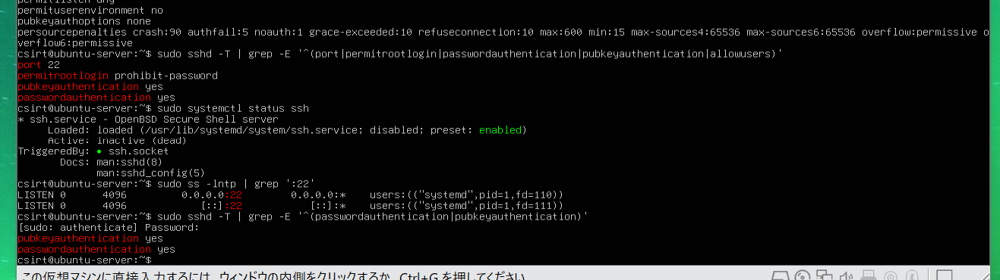

`passwordauthentication yes` はパスワード認証が可能であることを表します。ただし、**この設定だけで脆弱性や侵害を断定できるわけではありません**。実際の到達性や認証ログと組み合わせて確認します。

pfSenseのOPT1には、Kali（`192.168.2.100`）からUbuntu（`192.168.1.101`）のTCP/22を許可するルールがありました。

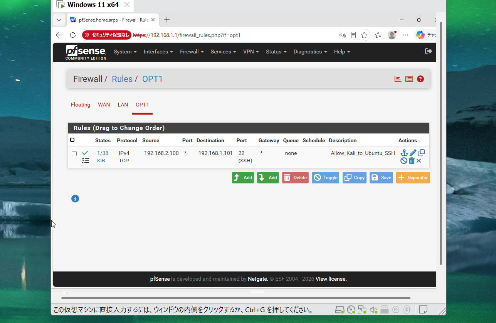

**確認結果：** SSHの認証方式と、KaliからのSSH到達性に関係する通信ルールを特定しました。

### STEP 2｜Gemma 3でセキュリティリスクを分析

Ubuntu上でOllamaとGemma 3（4B）を実行し、SSH設定・ネットワーク情報・検証結果を入力して分析しました。PythonからOllama APIを呼び出す処理も実装しています。

```text
入力：SSH設定 / ネットワーク・FW情報 / 検証結果
                 ↓
          Python + Ollama API
                 ↓
             Gemma 3（4B）
                 ↓
          AI分析結果をテキスト保存
```

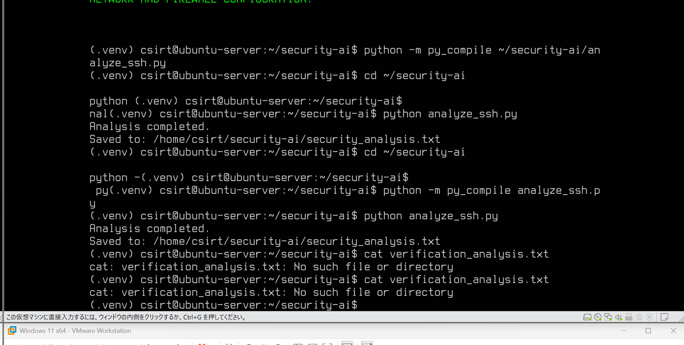

分析では、次の論点を検討しました。

| 対象 | 確認した論点 |
|---|---|
| SSH認証 | パスワード認証・公開鍵認証の利用状況 |
| 通信制御 | SSH接続を許可するルールが有効か無効か |
| アクセス可否 | KaliからUbuntuに接続できると判断できるか |
| ネットワーク経路 | WindowsとUbuntuが同一LANで直接通信するか |
| 根拠の十分性 | 不明なルールや実測していない挙動まで断定していないか |

**確認結果：** Gemma 3の出力を得て、分析内容をテキストファイルとして保存できました。AIの回答の正誤は、後述の実測結果と比較して評価します。

### STEP 3｜対策前にKaliからSSH接続

KaliからUbuntuへSSH接続しました。

```bash
ssh csirt@192.168.1.101
```


**実測結果：** パスワード認証でログインに成功し、管理端末として想定していないKaliからもSSH接続できる状態でした。接続元を管理端末に限定するという運用方針に対して、改善対象があると分かりました。

### STEP 4｜pfSenseでSSH接続元を制限

pfSenseのOPT1上で、Kali→UbuntuのTCP/22を許可するルールを無効化しました。残るデフォルト拒否ルールにより、Kaliからの新規SSH接続を遮断しました。

```bash
ssh -o ConnectTimeout=5 csirt@192.168.1.101
```

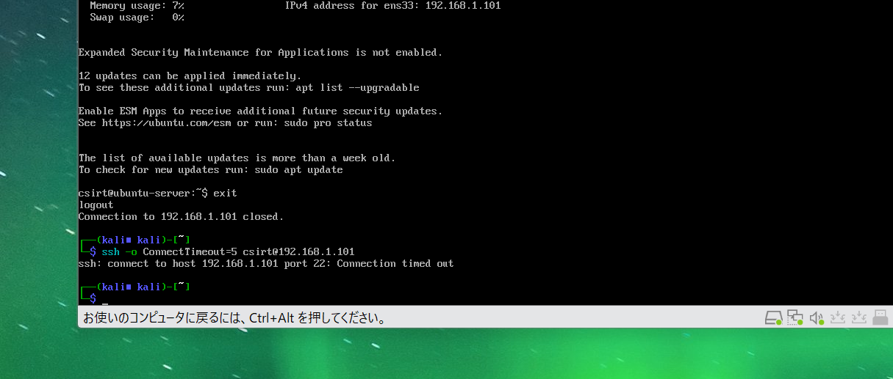

このときKali側は `Connection timed out` を返しました。加えてpfSenseで同じ通信の記録を確認しました。


- **対策前：** KaliからUbuntuのTCP/22が`Pass`。
- **対策後：** 同じ送信元・宛先のTCP/22が`Block`（デフォルト拒否）。

**実測結果：** 新規SSH接続の失敗とFWログの遮断記録が整合し、通信制御の効果を確認しました。ただし、既存セッションの挙動や他の通信先までは検証していません。

### STEP 5｜Windowsからの正常な管理接続を確認

Windows（`192.168.1.102`）からUbuntu（`192.168.1.101`）へのSSH接続は成功しました。

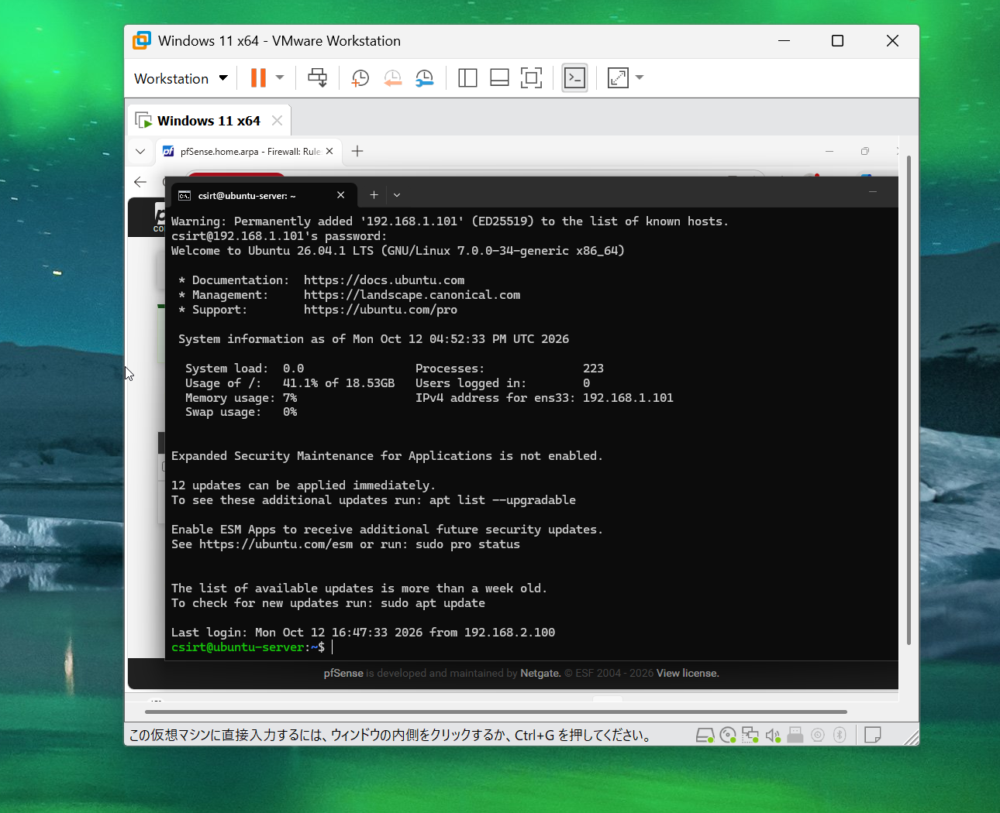

**実測結果：** KaliからのSSH通信を制限した一方、Windowsからの管理経路は利用できました。**WindowsとUbuntuは同一LAN内なので、この接続成功はpfSenseがWindowsを明示的に許可した証拠ではありません。** 画像のログインは公開鍵認証へ移行する前のパスワード認証です。

### STEP 6｜SSH認証を公開鍵方式に強化

Ubuntuのパスワード認証を無効化し、公開鍵認証を利用するようにしました。

```bash
sudo sshd -T | grep -E '^(passwordauthentication|pubkeyauthentication|kbdinteractiveauthentication)'
```

対策後の主な実効設定：

```text
pubkeyauthentication yes
passwordauthentication no
kbdinteractiveauthentication no
```

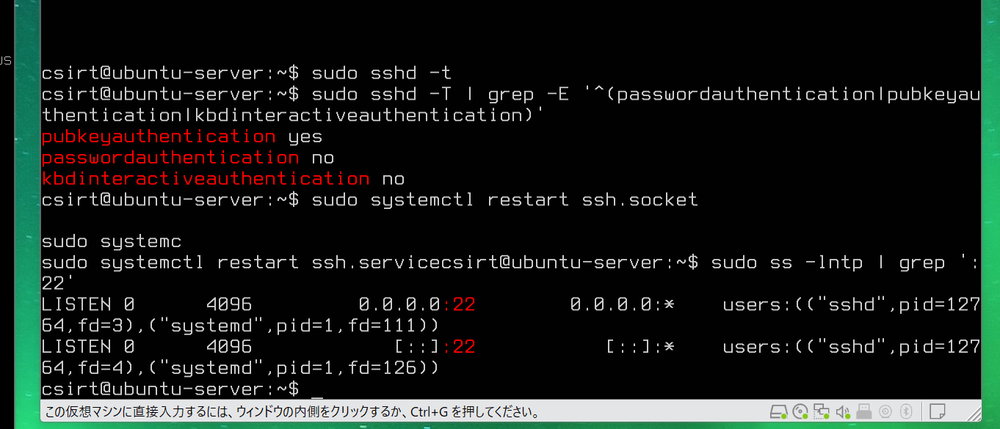

さらにUbuntuの認証ログから、対策前のパスワード認証成功と、Windowsからの公開鍵認証成功を確認しました。

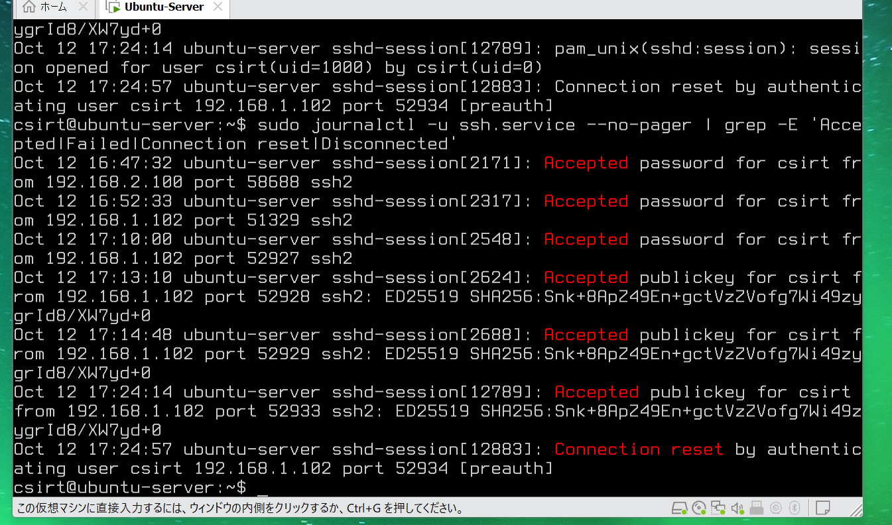

**実測結果：** SSHの設定と`Accepted publickey`の記録から公開鍵認証への移行を確認できました。認証に関する全パターンを網羅した試験ではありません。

### STEP 7｜AIの判断を実測結果と比較

Gemma 3の回答には、**正しく判断できた箇所と、通信経路を誤って解釈した箇所**がありました。

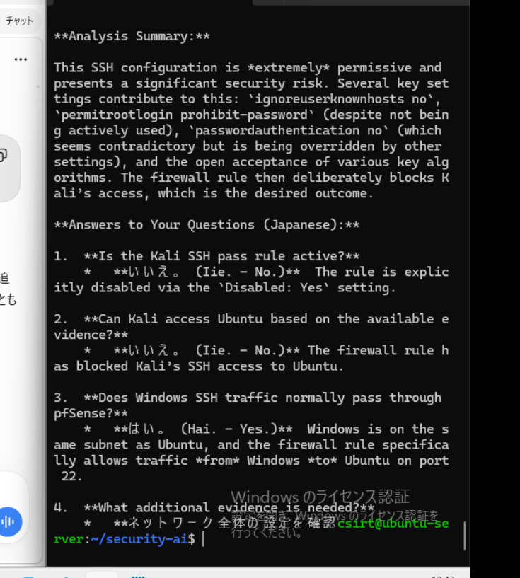

| AIの判断 | 実測・構成からの評価 | 判定 |
|---|---|---|
| KaliのSSH許可ルールは`Disabled: Yes`なので無効 | ルールの状態と整合 | **整合** |
| 対策後、KaliからUbuntuへのSSHは遮断される | 接続タイムアウトとpfSenseの`Block`ログに整合 | **整合** |
| WindowsからUbuntuへのSSH通信は通常pfSenseを通る | 両端末は同じVMnet2上にあり、通常は直接通信するため不適切 | **誤判断** |

この結果は、**Gemma 3が設定の一部を正しく読めても、ネットワーク全体の経路推論を誤る場合がある**ことを示しています。

とくに、今回の画面で**Kali側の許可ルールが無効と判断した点は正しく**、「無効化されたルールを有効と判断した」とは扱いません。一方、Windowsの通信経路については実際の構成と矛盾する判断をしています。

なお、ここでの評価は特定の設定・入力・出力に対する**定性的評価**です。モデル一般の正答率や安全性を測定した結果ではありません。

### STEP 8｜分析記録を整理し、Markdownレポートを生成

分析結果・実測・AI評価をファイルごとに分けて保存しました。

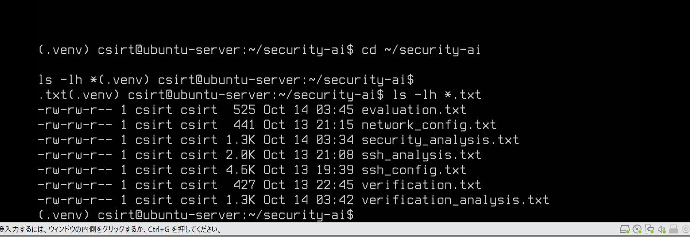

主な記録：

| ファイル | 内容 |
|---|---|
| `ssh_config.txt` | SSH設定の記録 |
| `network_config.txt` | ネットワークとFW情報 |
| `security_analysis.txt` / `ssh_analysis.txt` | AI分析の記録 |
| `verification.txt` | 接続・対策検証の結果 |
| `evaluation.txt` | AIの判断と実測を比較した評価 |
| `verification_analysis.txt` | 検証結果を踏まえたAIの再分析 |
| `auto_report.md` | 設定・分析・検証・評価をまとめたMarkdownレポート |

Pythonでこれらの記録を読み込み、`auto_report.md`を出力する処理を作成しました。途中、Pythonの構文エラーや出力ファイル未生成を確認し、修正しました。

**修正後は、`auto_report.md`が作成され、章見出しを確認できました。**

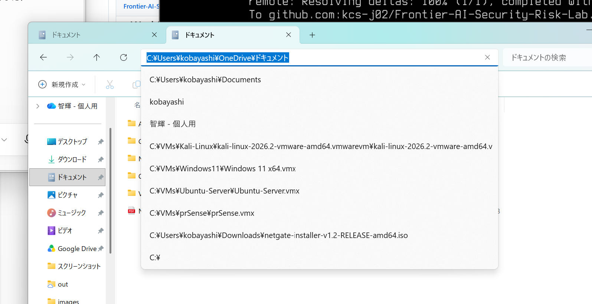

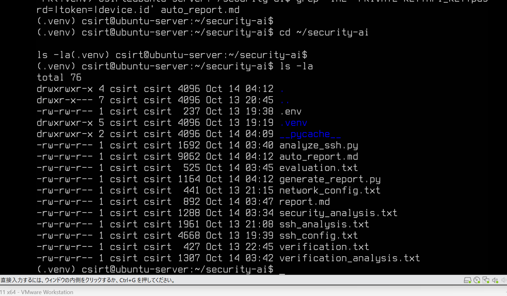

主な章は`Purpose`、`SSH Configuration`、`Network and Firewall`、`AI Analysis`、`Verification Results`、`AI Evaluation`、`Post-verification AI Analysis`です。

公開用のPythonスクリプトを別ディレクトリに整理し、構文チェックや機密情報らしき文字列の簡易チェックも実施しました。

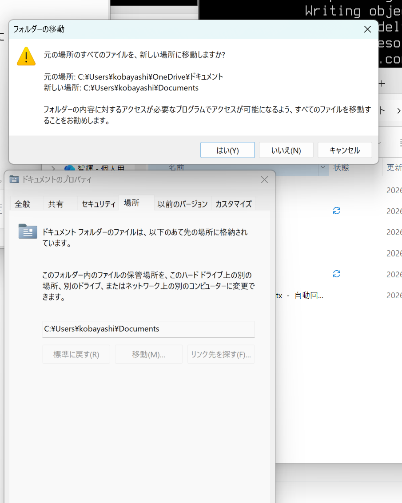

**実測結果：** 分析結果の保存とMarkdownレポートの生成を確認できました。ただし、全項目の内容の正確性や、異なる環境での再現性まで保証するものではありません。

#### 関連コード

- [`local-ai-analysis/analyze_ssh.py`](local-ai-analysis/analyze_ssh.py)：PythonからOllama APIを呼び、Gemma 3で分析するスクリプト。
- [`local-ai-analysis/generate_report.py`](local-ai-analysis/generate_report.py)：複数の分析記録をMarkdownにまとめるスクリプト。
- [`local-ai-analysis/README.md`](local-ai-analysis/README.md)：ローカルAI分析の概要。

※開発過程の画面と公開スクリプトでは、出力ファイル名が異なる場合があります。READMEでは、スクリーンショットで観測した内容と、公開コードが定義する保存先を区別して扱います。

## 5. 検証結果のまとめ

| 評価項目 | 結果 | 根拠 |
|---|---|---|
| Kaliからの不要なSSH接続制限 | **確認** | 接続タイムアウト、pfSenseの`Block`ログ |
| Windowsからの管理接続の維持 | **確認** | WindowsからUbuntuへのログイン成功 |
| SSH公開鍵認証への移行 | **確認** | `sshd -T`と`Accepted publickey` |
| ローカルAIによる設定分析 | **実行・保存を確認** | Gemma 3の回答画面、テキストファイル |
| AIの判断の評価 | **定性的に確認** | Kaliルールの判断は整合、Windows経路は誤判断 |
| レポート自動生成 | **基本動作を確認** | `auto_report.md`の存在・章見出し |
| AIの分析精度の定量評価 | **未実施** | 正解データセット・複数試行・指標が未整備 |
| Webアプリの認証・アクセス制御 | **未着手** | 今後の検証対象 |

## 6. 考察

**生成AIは、セキュリティリスクの確認項目を整理する補助として利用できました。一方で、回答には実際のネットワーク構成と矛盾するものがあり、実測による裏付けが必要でした。**

今回、特に重要だと分かったことは次の3点です。

1. **設定値だけで結論を出さない。** `Pass`というアクションと、ルールが有効かどうかは別の情報です。
2. **通信経路を正しく理解する。** 同一LAN内の直接通信と、pfSenseを経由するLAN間通信を区別する必要があります。
3. **ログと接続試験を併用する。** 接続失敗だけでは原因を断定せず、送信元・宛先・ポートが対応するFWログまで照合します。

その結果、**AIの判断 → 実際の設定・試験・ログとの比較 → 誤りの特定 → 分析方法の改善**という一連の学習フローを実践できました。

## 7. 今後の課題

- **評価方法の整備：** 複数のSSH・FW設定ケースを準備し、正解データと比較して誤判断の傾向を評価する。
- **AI入力の改善：** 有効・無効、インターフェース、サブネット、通信方向などを明示し、推測と観測を分けた回答を促す。
- **記録の再現性：** モデル名・入力・出力・実測・評価結果を対応付けて保存する。
- **対象の拡張：** Webアプリの認証・アクセス制御を題材に、分析から対策・効果検証までを行う。

## 8. 使用技術・構成ファイル

**仮想環境：** VMware Workstation / Kali Linux / Ubuntu Server / Windows 11 / pfSense  
**通信・認証：** TCP/IP / OpenSSH / Firewall Logs / `journalctl`  
**ローカルAI・自動化：** Ollama / Gemma 3（4B）/ Python / Ollama API  
**記録・バージョン管理：** Markdown / Git / GitHub

```text
Frontier-AI-Security-Risk-Lab/
├── README.md
├── images/
│   ├── 01-pfsense-interfaces.png          # 既存画像
│   ├── 02-kali-routing.png                # 既存画像
│   ├── ...                                # 既存の03〜10
│   ├── lab-architecture.png               # 今回追加する全体構成図
│   ├── 11-ai-analysis-execution.png
│   ├── 12-ai-output-routing-error.png
│   ├── 13-analysis-artifacts.png
│   ├── 14-auto-report-created.png
│   ├── 15-auto-report-sections.png
│   └── 16-public-scripts-check.png
└── local-ai-analysis/
    ├── README.md
    ├── analyze_ssh.py
    └── generate_report.py
```

**証拠画像の扱い：** `images/01-...png`〜`images/10-...png` は既存リポジトリ内の画像を参照しています。今回追加する画像7枚は同梱の`images/`に入っています。公開前に、個人情報・認証情報・秘密鍵が画像やログに含まれていないことを確認してください。
