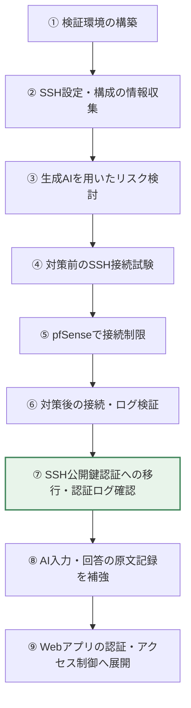
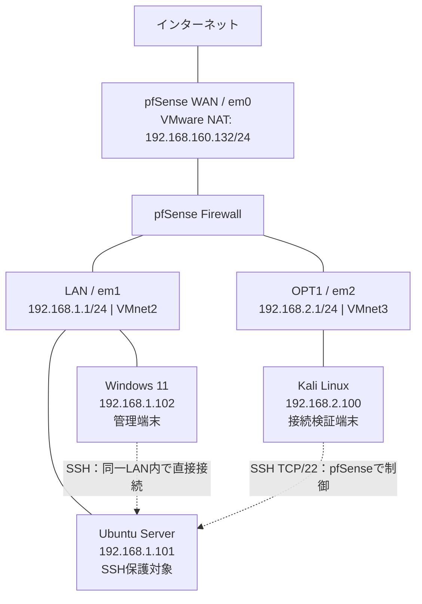

# Frontier AI Security Risk Analysis Lab

> **生成AIのリスク分析を、実際の接続試験とログで確かめる自主学習**
>
> NTTドコモビジネスのCRXソリューションにおける「フロンティアAI」への関心から、生成AIを用いたセキュリティリスク分析と、その分析結果の実機検証を独立した仮想環境で実践した記録です。

**本リポジトリは学習目的の独自実験です。実際のCRX製品、フロンティアAIの実装・モデル・内部機能を使用または再現したものではありません。** 生成AIによる仮説と実機で観測した事実を区別し、対策の効果を検証する一連の流れを疑似体験しています。

## タスクフローと現在地（2026年10月13日時点）

本実験は、**CRXソリューションの「フロンティアAI」を参考に、生成AIによるリスク分析を実機の通信・認証ログで検証する**ことを目的としています。現在は **SSHを題材にした対策・効果検証まで完了** し、**AI分析の原文記録の整備とWebアプリへの展開が次の課題**です。



| 工程 | 実施内容 | 現在の状態 | README内の証拠 |
|---|---|---|---|
| ① 環境構築 | pfSense・Kali・Ubuntu・Windowsの仮想ネットワークを構築 | ✅ 完了 | 画像01・02、[構成図](#2-仮想環境とネットワーク構成) |
| ② 情報収集 | UbuntuのSSH実効設定を確認 | ✅ 完了 | 画像07 |
| ③ AIによる分析 | 接続許可範囲や認証方式のリスク・対策を検討 | ◐ 実施内容を整理済み／当時のAI回答原文は未収録 | [分析観点](#3-ssh設定からリスクを分析) |
| ④ 対策前検証 | KaliからUbuntuへSSH接続 | ✅ 完了 | 画像03・09 |
| ⑤ 通信制御 | pfSenseのOPT1上のSSH許可ルールを無効化 | ✅ 完了 | 画像04（変更前の許可ルール）、画像10（遮断記録） |
| ⑥ 効果検証 | Kaliの接続失敗、pfSenseのBlock、Windowsの接続維持を確認 | ✅ 完了 | 画像05・06・10 |
| **⑦ 認証強化（現在の到達点）** | パスワード認証を無効化し、公開鍵認証・認証ログを確認 | **✅ 完了** | 画像08・09 |
| ⑧ AI分析の記録強化 | 実際のAI入力・回答、あるいは再実施した分析を明示して保存 | ⏳ 未完了 | 画像・原文は未収録 |
| ⑨ 次の対象への展開 | Webアプリの認証・アクセス制御を分析・検証 | ⏳ 未着手 | [今後の取り組み](#10-今後の取り組み) |

**到達点：** 「接続試験 → 対策 → 再試験 → ファイアウォール・認証ログで確認」の実証まで完了しました。フロンティアAIそのものの機能再現や、Webアプリの検証が完了したという意味ではありません。

## 1. 目的と検証結果

Ubuntu Server の SSH 接続を題材に、次の問いを検証しました。

- 生成AIは、SSH設定とネットワーク構成から、確認すべきリスクと対策案を整理できるか。
- 本来の管理端末ではない Kali Linux から Ubuntu の SSH に接続できるか。
- pfSense で Kali からの SSH を制限したとき、実際に通信が遮断されるか。
- Windows からの管理用接続を維持できるか。
- SSH認証を公開鍵方式に移行し、OS側の設定と認証ログでも確認できるか。

### 結果サマリー

| 検証 | 実測結果 | 主な証拠 |
|---|---|---|
| 対策前：Kali → Ubuntu の SSH | **成功**（パスワード認証） | [画像03](#4-対策前のssh接続試験)・[画像09](#8-ubuntuのssh認証ログを分析) |
| pfSense の SSH 許可ルール | OPT1 上の TCP/22 許可ルールを確認 | [画像04](#5-pfsenseでssh通信を制御) |
| 対策後：Kali → Ubuntu の SSH | **失敗**（接続タイムアウト） | [画像05](#6-対策後の接続試験とログ) |
| pfSense の通信ログ | 同じ宛先 TCP/22 に対して **Pass / Block** を確認 | [画像10](#6-対策後の接続試験とログ) |
| Windows → Ubuntu の SSH | **成功**（撮影時はパスワード認証） | [画像06](#7-windowsからの管理接続を確認) |
| Ubuntu のSSH認証強化 | `passwordauthentication no`、`pubkeyauthentication yes` | [画像08](#8-ubuntuのssh認証ログを分析) |
| Ubuntu の認証ログ | パスワード認証成功と公開鍵認証成功の記録を確認 | [画像09](#8-ubuntuのssh認証ログを分析) |

## 2. 仮想環境とネットワーク構成

VMware Workstation 上に、隔離した検証用ネットワークを作成しました。



| 機器 | IP | 役割 |
|---|---|---|
| pfSense 2.9.0 | WAN: `192.168.160.132` / LAN: `192.168.1.1` / OPT1: `192.168.2.1` | 異なる仮想LAN間の通信制御 |
| Kali Linux | `192.168.2.100` | 管理端末以外からのSSH到達性を検証 |
| Ubuntu Server | `192.168.1.101` | SSHサービスの保護対象 |
| Windows 11 | `192.168.1.102` | 正規の管理端末 |

### 証拠画像 01：pfSense のインターフェース設定

WAN = `em0`、LAN = `em1`、OPT1 = `em2` の割り当てと、各ネットワークのゲートウェイIPを確認できます。


### 証拠画像 02：Kali のルーティング

`ip route` により、Kali のデフォルトゲートウェイが `192.168.2.1`（pfSense OPT1）であることを確認しました。この画像の上部にある `ip -4` のエラーは、コマンド指定が不完全だったためで、経路の確認結果には影響しません。


## 3. SSH設定からリスクを分析

### 対策前の実効設定

Ubuntu で以下のコマンドを実行し、SSHサーバーの設定を確認しました。

```bash
sudo sshd -T | grep -E '^(port|permitrootlogin|passwordauthentication|pubkeyauthentication)'
```

**撮影時の実測値：**

```text
port 22
permitrootlogin prohibit-password
pubkeyauthentication yes
passwordauthentication yes
```

### 証拠画像 07：対策前のSSH設定


### 生成AIによるリスク検討の整理

この設定と「管理端末以外からも到達できるか」というネットワーク上の論点を、生成AIを用いた分析・検証の題材としました。以下は**実験内容をもとに整理した分析観点**であり、過去のAI出力を逐語的に再掲したものではありません。

| 分析対象 | 想定リスク・確認事項 | 検証・対応方針 |
|---|---|---|
| `passwordauthentication yes` | パスワード認証が利用可能。これだけで脆弱性とは断定できないが、認証試行の対象になり得る | 認証ログを確認し、公開鍵認証への移行を検証 |
| SSHへの接続元制限 | 正規の管理端末以外から SSH に到達できないか | Kali から TCP/22 に接続試験 |
| pfSense のアクセスルール | OPT1 から LAN への SSH 通信が通る設定になっていないか | ルールの状態とファイアウォールログを比較 |
| 対策後の業務影響 | 制限後も管理端末からアクセスできるか | Windows → Ubuntu の SSH 接続試験 |

**分析に対する姿勢：** 設定値だけで「攻撃を受けた」「侵害されている」とは判断せず、接続結果とログで確認できる範囲を明確にします。

## 4. 対策前のSSH接続試験

Kali Linux から Ubuntu Server へSSH接続しました。

```bash
ssh csirt@192.168.1.101
```

接続先のホスト鍵を確認した後、パスワードを入力してログインできました。`csirt@ubuntu-server:~$` というプロンプトが表示されており、**管理端末以外からSSH認証まで成功した**ことが分かります。

### 証拠画像 03：KaliからのSSHログイン成功


**判断：** SSHの接続許可範囲を管理端末に限定したい運用方針に対して、Kali側にも許可されていたことが課題でした。このSSH接続は自分で管理する検証環境内で実施したものです。

## 5. pfSenseでSSH通信を制御

Windows の pfSense 管理画面で `Firewall → Rules → OPT1` を確認しました。

| 設定項目 | 許可ルールの内容 |
|---|---|
| Interface | OPT1 |
| Action | Pass |
| Protocol | IPv4 TCP |
| Source | `192.168.2.100`（Kali） |
| Destination | `192.168.1.101`（Ubuntu） |
| Destination Port | `22`（SSH） |
| Description | `Allow_Kali_to_Ubuntu_SSH` |

### 証拠画像 04：SSH許可ルール

画像は許可ルールが**有効だった時点**の画面です。検証後、この許可ルールを無効化し、OPT1のデフォルト拒否でKaliからの新規SSH通信を遮断しました。**無効化直後のルール画面は、この10枚には含まれていません**。遮断の実際の動作は次節の接続結果とログで確認します。


## 6. 対策後の接続試験とログ

SSH許可ルールの無効化後、Kaliで再度接続試験を行いました。

```bash
ssh -o ConnectTimeout=5 csirt@192.168.1.101
```

### 証拠画像 05：Kaliからの接続タイムアウト

`Connection timed out` となり、新規SSH接続に成功しませんでした。


### 証拠画像 10：pfSenseによるSSH通信の許可と遮断

`Status → System Logs → Firewall` で、送信元 `192.168.2.100`、宛先 `192.168.1.101:22`、OPT1 上の通信を確認しました。

- **01:46:19：Pass** — Kali → Ubuntu のTCP/22が許可された記録。
- **01:50:36〜01:50:40：Block** — 同じ送信元・宛先・宛先ポートの通信が `Default deny rule IPv4` により遮断された記録。


**判断：** 接続試験のタイムアウトに加え、pfSenseのログで該当TCP/22のBlockを確認できたため、ネットワーク側で遮断したことを裏付けられました。ログは新規接続試行を対象とするもので、既存セッションの扱いを包括的に検証したものではありません。

## 7. Windowsからの管理接続を確認

Windows（`192.168.1.102`）から Ubuntu（`192.168.1.101`）へのSSHログイン成功を確認しました。

### 証拠画像 06：WindowsからUbuntuへの接続成功

この画像は**公開鍵への移行前のパスワード認証によるログイン**を示しています。画面下部の `Last login ... from 192.168.2.100` は、直前にKaliからログインした履歴であり、現在のWindowsからの接続元を示すものではありません。


**ネットワーク上の注意：** WindowsとUbuntuは同一LAN（VMnet2）にあるため、この通信は通常pfSenseを経由しません。「WindowsだけをpfSenseが明示的に許可した」という実験結果ではなく、**Kali側からの接続を遮断しつつ、既存の管理経路が利用できた**という結果です。

## 8. UbuntuのSSH認証ログを分析

ネットワーク側の制限に加え、UbuntuのSSH認証を公開鍵中心に強化しました。

```bash
sudo sshd -T | grep -E '^(passwordauthentication|pubkeyauthentication|kbdinteractiveauthentication)'
```

**変更後の実効設定：**

```text
pubkeyauthentication yes
passwordauthentication no
kbdinteractiveauthentication no
```

### 証拠画像 08：認証強化後の実効設定

画像には上記設定のほか、TCP/22 が待ち受け状態であることも示されています。


### 証拠画像 09：SSH認証ログによる比較

```bash
sudo journalctl -u ssh.service --no-pager \
  | grep -E 'Accepted password|Accepted publickey|Connection reset'
```

この画像では以下を確認できます。

- `Accepted password ... from 192.168.2.100`：対策前、Kaliからのパスワード認証に成功。
- `Accepted password ... from 192.168.1.102`：Windowsからのパスワード認証に成功。
- `Accepted publickey ... from 192.168.1.102`：Windowsからの公開鍵認証に成功。
- `Connection reset ... [preauth]`：認証が完了する前に通信がリセット。**これだけではパスワード認証が拒否された直接証拠とは断定しません。**


公開鍵認証での接続成功と、`passwordauthentication no` の実効設定を確認しました。パスワード認証のみを使用する接続試験についても別途実施しましたが、その結果のスクリーンショットはこのリポジトリには含めていません。

## 9. AI分析と実測結果の照合

| 分析・対策の論点 | 実施した操作 | 証拠から言えること | 限界 |
|---|---|---|---|
| 管理端末以外へのSSH到達性 | KaliからSSHログイン | 対策前はSSH認証まで成功 | 悪意ある攻撃を受けた証拠ではない |
| 不要なSSHアクセスの制限 | pfSense OPT1 の許可ルールを無効化 | 接続タイムアウト、TCP/22 Blockログ | 既存セッションや他の通信先は未評価 |
| 正常な管理アクセスの維持 | WindowsからUbuntuへSSH | 管理アクセス成功 | 同一LANの直接通信なのでpfSenseの許可を実証するものではない |
| SSH認証方式の強化 | 公開鍵登録・パスワード認証無効化 | 実効設定と `Accepted publickey` を確認 | 認証試行の全パターンを網羅していない |

### 学んだこと

生成AIによる分析だけで対策の有効性を断定するのではなく、**設定確認 → 接続試験 → 通信ログ・認証ログによる裏付け**を一貫して行うことが重要だと分かりました。特に「接続できない」という観測だけでなく、ファイアウォール側に一致する遮断記録があるかを調べることで、原因の特定に近づけました。

## 10. 今後の取り組み

- **Webアプリケーションの認証・アクセス制御**を対象に、生成AIでリスクと検証手順を整理し、隔離環境で検証する。
- AIへの入力・回答・その後の実測を一連の実験記録として保存し、再現性を高める。
- 必要に応じて、端末ログやネットワーク監視を組み合わせた分析にも対象を広げる。

上記は**今後の計画であり、今回完了した実験の成果ではありません。**


