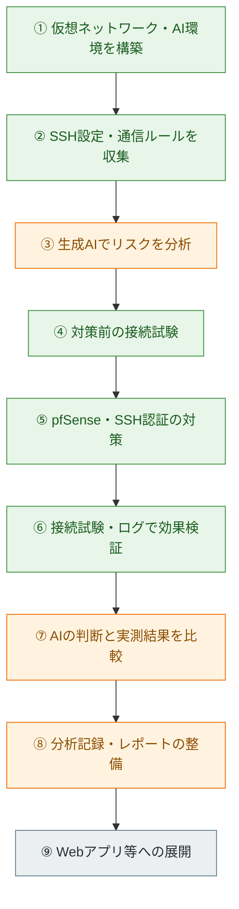

# Frontier AI Security Risk Analysis Lab

> **生成AIを活用したセキュリティリスク分析を、実際の設定・接続試験・ログで評価する自主学習プロジェクト**

本プロジェクトは、NTTドコモビジネスのCRXソリューションにおける「フロンティアAI」の考え方を参考に、生成AIを使ったリスク分析から実機検証、対策、効果確認までを実践するものです。

**注意：** 本リポジトリは独自の学習実験です。CRX製品や「フロンティアAI」の実装・内部機能を使用、再現したものではありません。実験は自分で管理する仮想環境内で実施しています。

## 1. 目的

**生成AIを活用してシステムのセキュリティリスクを分析し、実際の検証と対策を通じて、AIによるリスク分析の有効性を評価する。**

今回はUbuntu ServerのSSH設定とpfSenseの通信制御を対象に、次の3点を確認します。

1. **リスクの発見：** 生成AIがSSHの認証設定や接続許可範囲について、確認すべき問題点を整理できるか。
2. **対策の検証：** AI分析で扱った論点に対し、通信制御・認証強化の前後で挙動がどう変わるか。
3. **AIの有効性の評価：** AIの判断が設定・接続試験・ログと整合するか。誤判断や判断不能な点は何か。

「AIがリスクを指摘した」という出力自体を成果とせず、**実際に観測した事実と照合して評価すること**を重視しています。

## 2. 検証環境

### 全体構成図


VMware Workstation上に仮想マシンを用意しました。Ubuntu ServerではSSHサーバーを動かし、Ollama・Gemma 3を用いたローカルAI分析にも取り組みました。

| 機器・ソフトウェア | IPアドレス / 構成 | 役割 |
|---|---|---|
| Kali Linux | `192.168.2.100` / VMnet3 | 管理端末以外からのSSH接続試験 |
| Ubuntu Server | `192.168.1.101` / VMnet2 | SSHの保護対象、ローカルAIの実行環境 |
| Windows 11 | `192.168.1.102` / VMnet2 | 正規の管理端末 |
| pfSense 2.9.0 | WAN `192.168.160.132` / LAN `192.168.1.1` / OPT1 `192.168.2.1` | LAN間通信の制御・ログ記録 |
| Ollama / Gemma 3（4B） | Ubuntu上でローカル実行 | 設定・接続試験結果を用いたリスク分析 |
| Python | Ollama APIとの連携 | AI分析の実行・結果保存・レポート生成 |

**通信経路の注意：** Kali（VMnet3）からUbuntu（VMnet2）への通信はpfSenseのルールで制御します。一方、WindowsとUbuntuは同一LANにあり、通常この2台のSSH通信はpfSenseを通りません。したがって、Windows側の接続成功は「pfSenseがWindowsを明示的に許可した」証拠ではありません。

SSH実験のネットワーク設定は、以下の画像で確認できます。


## 3. ワークフローと進捗



| 工程 | 内容 | 状態 |
|---|---|---|
| ① 環境構築 | Kali・Ubuntu・Windows・pfSenseの構築、Ollama・Gemma 3の分析環境準備 | 完了・実施済み |
| ② 情報収集 | SSHの実効設定、ネットワーク、pfSenseのルールを確認 | 完了 |
| ③ AI分析 | SSH設定と通信ルールについてGemma 3で分析 | 実施済み（分析記録の整備は継続） |
| ④ 対策前検証 | KaliからUbuntuへのSSHログイン | 完了 |
| ⑤ 対策 | pfSenseのSSH許可ルールを無効化、SSH公開鍵認証へ移行 | 完了 |
| ⑥ 効果検証 | Kaliの接続失敗、Windowsの接続成功、通信・認証ログを確認 | 完了 |
| ⑦ AI評価 | ファイアウォールルール等のAI解釈と実測結果を比較 | 実施済み（評価方法を改善中） |
| ⑧ 記録・自動化 | PythonのAI分析・Markdownレポート生成スクリプトを作成 | スクリプト作成済み |
| ⑨ 対象拡張 | Webアプリの認証・アクセス制御の検証 | 未着手 |

以下では、**「実際の観測結果」「AI分析で判明したこと」「まだ確認できていないこと」**を区別して記録します。

## 4. 段階別の実験と結果

### STEP 1｜SSH設定と通信ルールの情報収集

UbuntuでSSHサーバーの実効設定を確認しました。

```bash
sudo sshd -T | grep -E '^(port|permitrootlogin|passwordauthentication|pubkeyauthentication)'
```

対策前に確認できた設定は以下です。

```text
port 22
permitrootlogin prohibit-password
pubkeyauthentication yes
passwordauthentication yes
```

`passwordauthentication yes` はパスワード認証が有効であることを示します。ただし、この設定だけで侵害や脆弱性の存在が確定するわけではありません。管理端末以外からSSHに到達できるかも合わせて調べる必要があります。


pfSenseでは、当初OPT1にKali（`192.168.2.100`）からUbuntu（`192.168.1.101`）のTCP/22を許可するルールがありました。


**この段階の結果：** SSHの認証方式と、KaliからのSSH通信に関係する許可ルールを特定しました。

### STEP 2｜生成AIでリスクを分析

UbuntuにOllama・Gemma 3（4B）を導入し、SSH設定とネットワーク・ファイアウォール情報を用いて分析しました。

検討対象は次のとおりです。

| 分析対象 | AIに評価させる論点 |
|---|---|
| SSH認証設定 | パスワード認証によるリスクと公開鍵認証の必要性 |
| 接続元制限 | 管理端末以外からSSHに接続できる可能性 |
| pfSenseルール | `Pass` と `Disabled` を区別して有効な許可ルールを判断できるか |
| ネットワーク構成 | WindowsとUbuntuの同一LAN内通信を正しく解釈できるか |
| 判断の根拠 | 不明なルールや未観測の事実を断定していないか |

**結果：** ローカルAIで設定を分析し、ファイアウォールの無効化された許可ルールを誤って解釈する事例が見られました。これにより、AIが設定の一部分だけから通信可否を断定する危険性が分かりました。

**記録上の制約：** 初期のAIへの入力・回答の完全な原文は、このREADMEの証拠画像として収録していません。したがって、具体的なAI発言の引用や分析精度の数値評価は行っていません。

### STEP 3｜対策前の接続試験

KaliからUbuntuのSSHへ接続しました。

```bash
ssh csirt@192.168.1.101
```

パスワード認証によるログインに成功し、管理用として想定していないKaliからもSSHを利用できる状態を確認しました。


**この段階の結果：** 接続許可範囲を管理端末に限定する方針に対して、対策前はKaliからのアクセスが可能でした。

### STEP 4｜通信制御の対策・効果検証

pfSenseのOPT1上で、KaliからUbuntuのTCP/22を許可するルールを無効化し、デフォルト拒否で新規SSH通信を遮断しました。

対策後、Kaliから再試行しました。

```bash
ssh -o ConnectTimeout=5 csirt@192.168.1.101
```

`Connection timed out` が表示され、SSH接続に失敗しました。


さらにpfSenseのFirewallログで、同じ送信元・宛先・TCP/22について、対策前の`Pass`と対策後の`Block`を確認しました。


**この段階の結果：** Kaliからの新規SSH接続は遮断され、pfSenseのログもその結果と整合しました。既存セッションやすべての通信経路を網羅的に評価したわけではありません。

### STEP 5｜正常な管理接続の維持

Windows（`192.168.1.102`）からUbuntu（`192.168.1.101`）へのSSHログインを確認しました。


**この段階の結果：** Kali側からの通信を遮断しながら、Windowsからの管理アクセスは利用できました。ただし、この2台は同一LAN内で直接通信するため、pfSenseによるWindowsの明示的な許可を示すものではありません。画像は公開鍵認証への移行前のパスワードログインです。

### STEP 6｜SSH公開鍵認証への移行

Ubuntuでパスワード認証を無効化し、公開鍵認証を有効化しました。

```bash
sudo sshd -T | grep -E '^(passwordauthentication|pubkeyauthentication|kbdinteractiveauthentication)'
```

対策後の実効設定は以下でした。

```text
pubkeyauthentication yes
passwordauthentication no
kbdinteractiveauthentication no
```


さらに認証ログから、対策前のパスワード認証成功と、Windowsからの公開鍵認証成功を確認しました。


**この段階の結果：** SSHの実効設定と認証ログによって、公開鍵認証への移行を確認できました。すべての認証失敗パターンを検証したわけではありません。

### STEP 7｜AIの判断と実測結果を比較

生成AIの解釈が実環境と一致するかを、設定・通信経路・ログから検討しました。

| 評価対象 | 実際に確認できた事実 | AI分析上の評価・課題 |
|---|---|---|
| SSHへの到達性 | 対策前はKaliからログイン成功 | 設定値だけでなく実際の到達性を確認する必要がある |
| pfSenseの許可ルール | 無効化後はKaliからの新規接続を遮断 | `Pass`というアクションとルールの有効・無効を混同する誤解釈が見られた |
| Windowsの通信経路 | WindowsとUbuntuは同一LAN内 | pfSenseを経由する通信と直接通信を区別する必要がある |
| SSH認証強化 | 公開鍵認証成功とパスワード認証無効の実効設定を確認 | 設定と認証ログを組み合わせて裏付ける必要がある |

**評価結果：** ローカルAIはリスクを検討する補助として利用できましたが、ファイアウォールルールを誤解釈する事例があり、回答を無条件に採用することはできません。実際の接続試験とログとの照合が、誤判断の発見に役立ちました。

現時点では、AI分析の正答率・再現率などを算出できるだけの評価データはなく、**AIの有効性を定量的に証明した段階ではありません**。

### STEP 8｜Pythonによる分析・レポート生成

ローカルAI分析と検証結果の整理を支援するPythonスクリプトを作成しました。

| ファイル | 機能 |
|---|---|
| [`local-ai-analysis/analyze_ssh.py`](local-ai-analysis/analyze_ssh.py) | SSH設定・ネットワーク情報・検証結果を読み込み、Ollama APIの`gemma3:4b`で分析して結果を保存 |
| [`local-ai-analysis/generate_report.py`](local-ai-analysis/generate_report.py) | 設定・分析・評価記録をMarkdown形式のレポートにまとめる |
| [`local-ai-analysis/README.md`](local-ai-analysis/README.md) | ローカルAI分析の目的・構成・手順の概要 |

**現在の状態：** スクリプトは作成済みです。実行環境や入力ファイルを含めた自動生成の再現性確認は、今後記録を充実させます。

## 5. 結果のまとめ

| 評価項目 | 結果 | 判断の根拠 |
|---|---|---|
| 不要なSSH接続の遮断 | **確認** | Kaliの接続タイムアウト、pfSenseのBlockログ |
| 正常な管理接続の維持 | **確認** | WindowsからUbuntuへのSSHログイン成功 |
| SSH公開鍵認証への移行 | **確認** | `sshd -T`の実効設定と`Accepted publickey`ログ |
| ローカルAIによる設定分析 | **実施** | Ollama・Gemma 3を用いた分析とPythonコード |
| AIの誤解釈の発見 | **確認** | 無効な許可ルールの解釈と、実際の通信制御との比較 |
| AI分析精度の定量評価 | **未実施** | 正解データセット、複数試行、評価指標が未整備 |
| Webアプリへの展開 | **未着手** | 今後の実験対象 |

## 6. 考察

今回の学習では、**生成AIのリスク分析は仮説の整理に役立つ一方、分析結果の正しさは設定・実機試験・ログで確かめる必要がある**と分かりました。

特に重要だった点は次の3つです。

1. **設定の意味を正しく読むこと：** ファイアウォールの`Pass`だけを見ても、そのルールが無効であれば通信を許可する根拠にはなりません。
2. **通信経路を区別すること：** 同一LAN内の通信と、pfSenseを経由するLAN間通信は分けて評価する必要があります。
3. **観測結果で判断を裏付けること：** 「接続できない」だけでなく、対応するBlockログまで確認すると、原因の切り分けに近づけます。

この経験を踏まえ、今後はAIへの入力情報の品質、判断根拠の示し方、複数回実行時の安定性を評価します。

## 7. 今後の取り組み

- **AI分析の再現性向上：** 入力設定、AIプロンプト、AI回答原文、実測結果を対応付けて保存する。
- **分析精度の評価：** 正解となる設定・通信結果を準備し、正誤や誤判断の傾向を比較する。
- **検証対象の拡張：** Webアプリの認証・アクセス制御を対象に、分析から対策・効果確認まで実施する。
- **ログの拡充：** 必要に応じて端末ログやネットワーク監視を組み合わせ、根拠を増やす。

## 8. 使用技術・関連資料

**仮想環境：** VMware Workstation / Kali Linux / Ubuntu Server / Windows 11 / pfSense  
**認証・ネットワーク：** OpenSSH / TCP/IP / Firewall Logs / Linux Logs  
**AI・自動化：** Ollama / Gemma 3（4B）/ Python / Ollama API  

- [ローカルAI分析コードと概要](local-ai-analysis/README.md)
- [セキュリティ基礎学習リポジトリ](https://github.com/kcs-j02/security)

**注記：** 図・IPアドレス・ログは個人の検証環境に対応します。学習目的の構成であり、実運用環境にそのまま適用できることを保証するものではありません。
